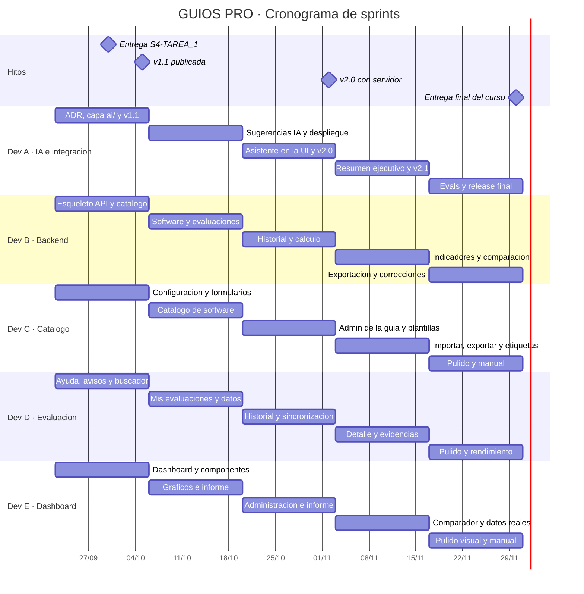

# Equipo, reparto de tareas y cronograma — GUIOS PRO

Documento de trabajo del equipo de desarrollo. Define quién construye qué, cuándo, y cómo llevarlo a un tablero de Jira.

- **Tareas completas (53) con criterios de aceptación:** [`docs/jira/TAREAS.md`](jira/TAREAS.md)
- **Archivo para importar en Jira:** [`docs/jira/backlog-jira.csv`](jira/backlog-jira.csv)
- **Fuente de verdad:** [`docs/jira/tareas.json`](jira/tareas.json) → `npm run build:jira` regenera los dos anteriores.

---

## 1. Equipo

Cinco desarrolladores. **Los devs B, C, D y E construyen funcionalidad** (pantallas, endpoints, componentes): cada uno es dueño de un módulo completo. **El Dev A se encarga de la integración con IA —la parte más difícil— y además de revisar los pull requests, integrar el trabajo de todos, desplegar y publicar cada versión**; nadie más toca el despliegue ni el repositorio publicado.

| Dev | Módulo que construye | Entregables principales | Es dueño de |
|---|---|---|---|
| **A** | **IA, integración y coordinación técnica** | Asistente de IA (sugerencias, resumen ejecutivo), revisión de PR, integración de módulos, despliegue y publicación de versiones, control de consumo de IA | `ai/`, `app/js/engine.js`, `.github/`, `docs/` |
| **B** | **Backend: API y base de datos** | Esqueleto de la API, catálogo, software candidato, evaluaciones, historial, cálculo en servidor, indicadores, comparación y exportación | `api/`, `db/` |
| **C** | **Catálogo de software y de la guía** | Configuración de la organización, formularios reutilizables, catálogo de softwares candidatos y su ficha, administración de la guía, plantillas de importancia, importar/exportar, etiquetas y notas | `app/js/pantallas/catalogo.js`, `app/js/pantallas/configuracion.js` |
| **D** | **Pantallas de evaluación** | Los 3 pasos de la guía, ayuda y validaciones, buscador de factores, «Mis evaluaciones», historial, detalle, evidencias, sincronización | `app/js/app.js`, `app/index.html` |
| **E** | **Dashboard, reportes y comparación** | **Dashboard de indicadores**, componentes KPI, gráficos, vista de informe, línea de tiempo de evaluaciones, comparador de candidatos | `app/js/pantallas/dashboard.js`, `app/css/` |

El **Product Owner** es el docente/autor de la guía GUIOS. El rol de **Scrum Master** rota cada sprint entre B, C, D y E.

### Pantallas nuevas y su responsable

| Pantalla | Dev | Sprint |
|---|---|---|
| **Dashboard** con indicadores de la organización | E | 1 (local) → 4 (datos reales) |
| Configuración de la organización | C | 1 |
| Catálogo de softwares candidatos | C | 2 |
| Ficha de un software | C | 2 |
| Mis evaluaciones | D | 2 |
| Vista de informe imprimible | E | 2 |
| Administración del catálogo de la guía | C | 3 |
| Plantillas de importancia | C | 3 |
| Historial de evaluaciones | D | 3 |
| Línea de tiempo en el dashboard | E | 3 |
| Detalle de una evaluación guardada | D | 4 |
| Importar y exportar datos | C | 4 |
| Comparador de candidatos | E | 4 |

> El sistema **no tiene cuentas de usuario ni inicio de sesión**: la organización y el evaluador se registran como datos de la evaluación. Esto simplifica el despliegue y evita almacenar credenciales.

### Matriz de responsabilidad (RACI)

| Área | A | B | C | D | E |
|---|---|---|---|---|---|
| Integración con IA | **R/A** | C | I | C | I |
| Revisión de PR, despliegue y publicación | **R/A** | C | C | C | C |
| API y base de datos | C | **R/A** | C | C | C |
| Catálogo de software y de la guía | C | C | **R/A** | C | I |
| Pantallas de la evaluación | I | C | I | **R/A** | C |
| Dashboard, informes y comparador | I | C | I | C | **R/A** |
| Sistema de diseño | I | I | C | C | **R/A** |
| Motor de cálculo (`engine.js`) | **R/A** | C | I | C | I |

R = responsable de hacerlo · A = aprueba · C = consultado · I = informado.

### Reglas de trabajo

1. **Una rama por tarea**: `feat/gp-e01-dashboard`, `fix/gp-d10-…`. Pull request obligatorio; **lo revisa y lo mezcla el Dev A**.
2. **Nadie despliega ni publica por su cuenta**: B, C, D y E entregan su trabajo en una rama; el Dev A integra, prueba el conjunto y publica la versión al cierre del sprint.
3. **Commits** con Conventional Commits en español citando el ID: `feat(gp-e01): pantalla dashboard con indicadores`.
4. **Cada dev prueba lo suyo**: su tarea llega a revisión con las pruebas que correspondan (unitarias, de contrato o E2E de su pantalla).
5. **Dependencias entre personas**: si una tarea bloquea a otra (columna *Depende de*), quien bloquea la prioriza al inicio del sprint. Mientras tanto, el frontend trabaja contra datos simulados.

---

## 2. Carga por desarrollador

Velocidad planificada: **~10 puntos por desarrollador y sprint**.

| Dev | Sprint 1 | Sprint 2 | Sprint 3 | Sprint 4 | Sprint 5 | Tareas | Puntos |
|---|---|---|---|---|---|---|---|
| **A** · IA e integración | 11 | 13 | 13 | 13 | 10 | 11 | **60** |
| **B** · Backend | 10 | 13 | 10 | 10 | 8 | 11 | 51 |
| **C** · Catálogo | 10 | 10 | 10 | 8 | 8 | 10 | 46 |
| **D** · Evaluación | 11 | 10 | 10 | 10 | 8 | 11 | 49 |
| **E** · Dashboard y reportes | 11 | 10 | 8 | 11 | 10 | 10 | 50 |
| **Total** | 53 | 56 | 51 | 52 | 44 | **53** | **256** |

El Dev A lleva la mayor carga: la integración con el modelo de lenguaje (lo de mayor riesgo técnico) más el trabajo de integrar y publicar lo que produce el resto del equipo.

---

## 3. Cronograma

Sprints de **2 semanas**, de martes a lunes. Sprint 0 ya está completado.

| Sprint | Fechas | Objetivo | Hito / entregable |
|---|---|---|---|
| **0** ✔ | 08 – 21 sep 2026 | Cimentación: repositorio, app rediseñada, motor probado, datos maestros, esquema de BD y CI | Informe Sprint 0 · app en `app/index.html` |
| **1** | **22 sep – 05 oct 2026** | Dashboard, configuración y mejoras de la evaluación sobre la app local; decisiones de IA y backend | **v1.1** publicada · tablero Jira operativo · entrega S4-TAREA_1 (30/09) |
| **2** | 06 – 19 oct 2026 | Catálogo de software, API de evaluaciones, gráficos e informe, primer servicio de IA | **v1.2** con API desplegada y catálogo en uso |
| **3** | 20 oct – 02 nov 2026 | Evaluaciones guardadas, historial, administración de la guía y asistente de IA | **v2.0** con evaluaciones en servidor |
| **4** | 03 – 16 nov 2026 | Comparador, dashboard con datos reales, evidencias y resumen ejecutivo con IA | **v2.1** con informe completo |
| **5** | 17 – 30 nov 2026 | Pulido de todas las pantallas, corrección de errores, manuales e informe final | **Release final** + entrega del curso |

### Diagrama de Gantt



### Calendario de ceremonias

| Ceremonia | Cuándo | Duración | Quién |
|---|---|---|---|
| Sprint Planning | Martes de inicio, 09:00 | 1 h 30 | Todo el equipo + PO |
| Daily | Lunes a viernes, 08:30 (o asíncrona en el chat antes de las 10:00) | 15 min | Equipo |
| Revisión de PR | Continua; el Dev A revisa en el día | — | A + autor |
| Refinamiento del backlog | Miércoles de la segunda semana, 16:00 | 1 h | Equipo + PO |
| Sprint Review (demo) | Lunes de cierre, 16:00 | 1 h | Equipo + PO |
| Retrospectiva | Lunes de cierre, 17:00 | 45 min | Equipo |

---

## 4. Cómo montar el tablero en Jira

### 4.1 Crear el proyecto

1. **Crear proyecto** → plantilla **Scrum**. Nombre: `GUIOS PRO`, clave: `GP`.
2. **Tipos de incidencia**: `Epic`, `Story`, `Task`, `Bug`. (Los *Spike* se importan como `Task` con la palabra «Spike» en el título.)
3. **Campos**: activar **Story Points**, `Componente`, `Etiquetas` y `Fecha de vencimiento`.
4. **Componentes** (Proyecto › Componentes): `IA`, `Integración`, `Backend`, `Catálogo`, `Evaluación`, `Dashboard`.
5. **Usuarios**: invitar a los 5 desarrolladores y anotar su correo para el paso 4.3.

### 4.2 Columnas del tablero y flujo

```
Backlog → Por hacer → En curso → En revisión (Dev A) → Listo para publicar → Hecho
```

- **En curso**: límite WIP de 2 incidencias por persona.
- **En revisión (Dev A)**: la incidencia entra aquí al abrir el pull request.
- **Listo para publicar**: aprobada y mezclada; sale en la próxima publicación de versión.
- **Hecho**: publicada y verificada en el entorno desplegado.

### 4.3 Importar el backlog

1. En [`docs/jira/backlog-jira.csv`](jira/backlog-jira.csv), sustituir los alias `dev-a` … `dev-e` de la columna **Assignee** por los correos reales (las etiquetas `dev-a`…`dev-e` se mantienen para filtrar).
2. Jira: **Configuración › Sistema › Importar datos externos › CSV** (o *Proyecto › Importar incidencias*).
3. Seleccionar el archivo, elegir el proyecto `GP`, **codificación UTF-8** y separador `,`.
4. Mapear: `Issue Type → Tipo`, `Summary → Resumen`, `Description → Descripción`, `Priority → Prioridad`, `Story Points → Puntos de historia`, `Sprint → Sprint`, `Assignee → Persona asignada`, `Component → Componentes`, las dos columnas `Labels → Etiquetas`, `Epic Name → Nombre de épica`, `Epic Link → Épica principal`, `Due Date → Fecha de vencimiento` (`yyyy-MM-dd`).
5. Importar: Jira crea los 5 sprints por nombre, las **6 épicas** y las **53 tareas** vinculadas.
6. Abrir el Backlog, comprobar las fechas de cada sprint (§3) e **iniciar el Sprint 1**.

> Si el importador rechaza las columnas repetidas `Labels`, deje solo la primera.

### 4.4 Filtros y vistas útiles (JQL)

```sql
-- Mi trabajo del sprint actual
project = GP AND sprint in openSprints() AND assignee = currentUser() ORDER BY priority DESC

-- Cola de revisión del Dev A
project = GP AND status = "En revisión (Dev A)" ORDER BY updated ASC

-- Todo lo pendiente de un módulo
project = GP AND component = "Dashboard" AND statusCategory != Done ORDER BY Sprint

-- Tareas estancadas
project = GP AND status = "En curso" AND updated <= -3d
```

---

## 5. Definición de Listo y Definición de Hecho

**Definición de Listo** (para entrar a un sprint): criterios de aceptación verificables, estimación en puntos, dueño, dependencias identificadas y, si toca la interfaz, referencia al sistema de diseño.

**Definición de Hecho** (para pasar a *Hecho*):

- [ ] Criterios de aceptación cumplidos y verificados por el Dev A en la revisión.
- [ ] `npm test` y las pruebas propias de la tarea en verde.
- [ ] Sin errores en la consola del navegador; la app sigue abriéndose desde `file://`.
- [ ] Responsive verificado a 390 px y en tema claro y oscuro.
- [ ] Documentación actualizada (`README`, `DESIGN-SYSTEM` o manuales según corresponda).
- [ ] Capturas regeneradas (`python scripts/screenshots.py`) si cambió la interfaz.
- [ ] Pull request aprobado y mezclado por el Dev A, y la funcionalidad publicada.

---

## 6. Riesgos y dependencias

| Riesgo | Impacto | Mitigación | Dueño |
|---|---|---|---|
| El backend (Sprint 2) se retrasa y bloquea a C, D y E | Alto | Las pantallas se construyen contra datos simulados y la capa de datos degrada a `localStorage` | B |
| Sin cuentas de usuario, cualquiera con acceso a la instancia ve las evaluaciones | Medio | Despliegue en la red institucional o tras un acceso restringido; si más adelante se requieren cuentas, el esquema admite añadirlas sin romper los datos | A |
| Cuello de botella en la revisión (todo pasa por el Dev A) | Medio | PR pequeños (una tarea), revisión en el día y límite WIP de 2 por persona | A |
| Coste o latencia de la IA por encima de lo previsto | Alto | Presupuesto fijado en el ADR, caché, límites por organización y modo sin IA siempre disponible | A |
| Respuestas del modelo inventadas o incoherentes con el cálculo | Alto | La IA nunca decide: solo sugiere; validación estricta del JSON; evals con umbral mínimo | A |
| Divergencia entre el cálculo del navegador y el del servidor | Medio | Suite compartida de casos que rompe la integración continua ante cualquier diferencia | A y B |
| Sobrecarga del equipo al coincidir con exámenes | Medio | Velocidad conservadora (10 pts/persona), Sprint 5 con menor carga y bolsas de corrección | Scrum Master |
