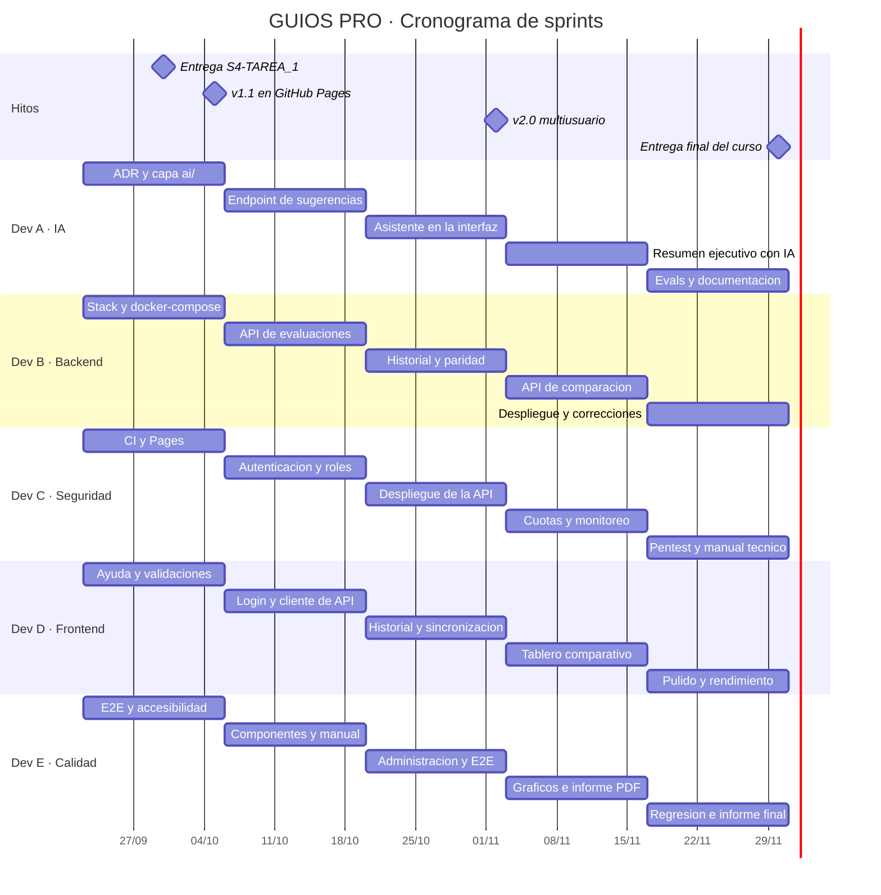

# Equipo, reparto de tareas y cronograma — GUIOS PRO

Documento de trabajo del equipo de desarrollo. Define quién hace qué, cuándo, y cómo llevarlo a un tablero de Jira.

- **Tareas completas (61) con criterios de aceptación:** [`docs/jira/TAREAS.md`](jira/TAREAS.md)
- **Archivo para importar en Jira:** [`docs/jira/backlog-jira.csv`](jira/backlog-jira.csv)
- **Fuente de verdad:** [`docs/jira/tareas.json`](jira/tareas.json) → `python scripts/build_jira.py` regenera los dos anteriores.

---

## 1. Equipo

Cinco desarrolladores, cada uno dueño de un área. El Dev A concentra la parte más difícil (integración con IA) y actúa como líder técnico.

| Dev | Área | Responsabilidades | Es dueño de |
|---|---|---|---|
| **A** | **IA e integraciones** *(líder técnico)* | Asistente inteligente, capa `ai/`, prompts versionados, guardarraíles de coste y seguridad, trazabilidad, evals de calidad, paridad del motor de cálculo | `ai/`, `app/js/engine.js`, `tests/` |
| **B** | Backend y base de datos | API REST, PostgreSQL, migraciones, contratos OpenAPI, rendimiento de consultas | `api/`, `db/`, `scripts/build_seed_sql.py` |
| **C** | Seguridad y DevOps | Autenticación y roles, secretos, CI/CD, despliegue, monitoreo, backups, auditoría | `.github/`, `.githooks/`, `api/auth/`, `docker-compose.yml` |
| **D** | Frontend y experiencia | Pantallas de los 3 pasos, historial, sincronización con la API, navegación y accesibilidad | `app/js/app.js`, `app/index.html` |
| **E** | Diseño, reportes, calidad y documentación | Sistema de diseño, gráficos e informes, pruebas E2E, manuales e informe académico | `app/css/`, `docs/`, `tests/ui/` |

El rol de **Scrum Master** rota cada sprint; el **Product Owner** es el docente/autor de la guía GUIOS.

### Matriz de responsabilidad (RACI)

| Área | A | B | C | D | E |
|---|---|---|---|---|---|
| Integración con IA | **R/A** | C | C | C | I |
| Motor de cálculo (`engine.js`) | **R/A** | C | I | C | C |
| API y base de datos | C | **R/A** | C | C | C |
| Autenticación y seguridad | C | C | **R/A** | C | I |
| CI/CD y despliegue | C | C | **R/A** | I | I |
| Interfaz de la evaluación | I | I | I | **R/A** | C |
| Sistema de diseño e informes | I | I | I | C | **R/A** |
| Pruebas E2E y accesibilidad | C | C | I | C | **R/A** |
| Documentación y entregables | C | C | C | C | **R/A** |

R = responsable de hacerlo · A = aprueba · C = consultado · I = informado.

### Reglas de trabajo

1. **Una rama por tarea**: `feat/gp-a04-sugerencia-ia`, `fix/gp-d10-…`. Pull request obligatorio con CI en verde y una aprobación de otro desarrollador.
2. **Revisión cruzada fija**: A↔B, C↔D, E revisa a todos (y A revisa a E). Nadie aprueba su propio PR.
3. **Commits** con Conventional Commits en español (`feat:`, `fix:`, `docs:`, `data:`, `design:`, `chore:`) citando el ID: `feat(gp-d06): pantalla de historial`.
4. **Nada se mezcla a `main`** sin cumplir la Definición de Hecho (§5).
5. **Dependencias entre personas**: si una tarea bloquea a otra (columna *Depende de*), quien bloquea la prioriza al inicio del sprint.

---

## 2. Carga por desarrollador

Velocidad planificada: **~10 puntos por desarrollador y sprint** (~50 por sprint el equipo).

| Dev | Sprint 1 | Sprint 2 | Sprint 3 | Sprint 4 | Sprint 5 | Tareas | Puntos |
|---|---|---|---|---|---|---|---|
| **A** · IA | 10 | 11 | 11 | 13 | 7 | 11 | **52** |
| **B** · Backend | 10 | 13 | 10 | 7 | 6 | 11 | 46 |
| **C** · Seguridad/DevOps | 10 | 10 | 10 | 6 | 8 | 14 | 44 |
| **D** · Frontend | 8 | 10 | 10 | 11 | 8 | 11 | 47 |
| **E** · Diseño/Calidad | 11 | 11 | 8 | 8 | 9 | 14 | 47 |
| **Total** | 49 | 55 | 49 | 45 | 38 | **61** | **236** |

El Dev A lleva la mayor carga y las tareas de mayor riesgo técnico (integración con el modelo de lenguaje, guardarraíles, evals y paridad del cálculo), tal como se acordó.

---

## 3. Cronograma

Sprints de **2 semanas**, de martes a lunes. Sprint 0 ya está completado.

| Sprint | Fechas | Objetivo | Hito / entregable |
|---|---|---|---|
| **0** ✔ | 08 – 21 sep 2026 | Cimentación: repositorio, app rediseñada, motor probado, datos maestros, esquema de BD y CI | Informe Sprint 0 · app en `app/index.html` |
| **1** | **22 sep – 05 oct 2026** | Prototipo pulido y decisiones técnicas cerradas (ADR de IA y de backend) | **v1.1** publicada en GitHub Pages · tablero Jira operativo · entrega S4-TAREA_1 (30/09) |
| **2** | 06 – 19 oct 2026 | Backend con PostgreSQL, login con roles y primer servicio de IA | API v0.1 documentada (OpenAPI) · login funcionando |
| **3** | 20 oct – 02 nov 2026 | Persistencia completa, historial, administración y asistente de IA en la interfaz | **v2.0 multiusuario** desplegada |
| **4** | 03 – 16 nov 2026 | Valor para el decisor: comparador, evidencias, gráficos y resumen ejecutivo con IA | **v2.1** con informe PDF completo |
| **5** | 17 – 30 nov 2026 | Estabilización: calidad de la IA, seguridad, rendimiento y entrega final | **Release final** + informe y presentación del curso |

### Diagrama de Gantt



### Calendario de ceremonias

| Ceremonia | Cuándo | Duración | Quién |
|---|---|---|---|
| Sprint Planning | Martes de inicio, 09:00 | 1 h 30 | Todo el equipo + PO |
| Daily | Lunes a viernes, 08:30 (o asíncrona en el chat antes de las 10:00) | 15 min | Equipo |
| Refinamiento del backlog | Miércoles de la segunda semana, 16:00 | 1 h | Equipo + PO |
| Sprint Review (demo) | Lunes de cierre, 16:00 | 1 h | Equipo + PO |
| Retrospectiva | Lunes de cierre, 17:00 | 45 min | Equipo |

---

## 4. Cómo montar el tablero en Jira

### 4.1 Crear el proyecto

1. **Crear proyecto** → plantilla **Scrum** → tipo *Gestionado por el equipo* (o por la empresa si quieren flujo personalizado). Nombre: `GUIOS PRO`, clave: `GP`.
2. **Tipos de incidencia** a habilitar: `Epic`, `Story`, `Task`, `Bug`. (Los *Spike* se importan como `Task` con la palabra «Spike» en el título.)
3. **Campos**: activar **Story Points** (estimación en puntos), `Componente`, `Etiquetas` y `Fecha de vencimiento`.
4. **Componentes** (Proyecto › Componentes): `IA`, `Backend`, `DevOps`, `Frontend`, `Calidad`, `Gestión`, con su responsable por defecto.
5. **Usuarios**: invitar a los 5 desarrolladores. Anotar el correo de cada uno para el paso 4.3.

### 4.2 Columnas del tablero y flujo

```
Backlog → Por hacer → En curso → En revisión (PR) → Pruebas/QA → Hecho
```

- **En curso**: límite WIP de 2 incidencias por persona.
- **En revisión**: la incidencia pasa aquí al abrir el pull request; la mueve el revisor asignado.
- **Pruebas/QA**: Dev E verifica los criterios de aceptación en el entorno desplegado.
- **Hecho**: solo si cumple la Definición de Hecho (§5).

### 4.3 Importar el backlog

1. Editar [`docs/jira/backlog-jira.csv`](jira/backlog-jira.csv) y sustituir los alias `dev-a` … `dev-e` de la columna **Assignee** por los correos reales del equipo (o dejarlos y asignar a mano después; las etiquetas `dev-a`…`dev-e` se mantienen para filtrar).
2. En Jira: **Configuración › Sistema › Importar datos externos › CSV** (o *Proyecto › Importar incidencias*).
3. Seleccionar el archivo, elegir el proyecto `GP` y **codificación UTF-8**, separador `,`.
4. Mapear las columnas: `Issue Type → Tipo`, `Summary → Resumen`, `Description → Descripción`, `Priority → Prioridad`, `Story Points → Puntos de historia`, `Sprint → Sprint`, `Assignee → Persona asignada`, `Component → Componentes`, las dos columnas `Labels → Etiquetas`, `Epic Name → Nombre de épica`, `Epic Link → Épica principal`, `Due Date → Fecha de vencimiento` (formato `yyyy-MM-dd`).
5. Importar. Jira crea los 5 sprints por nombre, las **6 épicas** y las **61 tareas** ya vinculadas.
6. Después de importar: abrir el Backlog, comprobar que cada sprint tiene sus fechas (§3) e **iniciar el Sprint 1**.

> Si el importador rechaza las columnas repetidas `Labels`, deje solo la primera: las etiquetas de sprint se pueden generar después con un filtro.

### 4.4 Filtros y vistas útiles (JQL)

```sql
-- Mi trabajo del sprint actual
project = GP AND sprint in openSprints() AND assignee = currentUser() ORDER BY priority DESC

-- Carga de un desarrollador
project = GP AND labels = "dev-a" AND statusCategory != Done

-- Tareas bloqueadas o sin avanzar
project = GP AND status = "En curso" AND updated <= -3d

-- Todo lo de IA pendiente
project = GP AND component = "IA" AND statusCategory != Done ORDER BY Sprint
```

Tableros recomendados: uno por **componente** (5 filtros rápidos en el tablero principal) y un **informe de velocidad** al cerrar cada sprint.

---

## 5. Definición de Listo y Definición de Hecho

**Definición de Listo** (para entrar a un sprint): la tarea tiene criterios de aceptación verificables, estimación en puntos, dueño, dependencias identificadas y, si toca la interfaz, un boceto o referencia del sistema de diseño.

**Definición de Hecho** (para pasar a *Hecho*):

- [ ] Criterios de aceptación cumplidos y verificados por otra persona.
- [ ] `npm test` y, si aplica, pruebas de contrato y E2E en verde.
- [ ] Sin errores en la consola del navegador; la app sigue abriéndose desde `file://`.
- [ ] Responsive verificado a 390 px y en tema claro y oscuro.
- [ ] Documentación actualizada (`README`, `DESIGN-SYSTEM`, `SPRINT-0` o manuales según corresponda).
- [ ] Capturas regeneradas (`python scripts/screenshots.py`) si cambió la interfaz.
- [ ] Pull request aprobado y mezclado a `main` con CI en verde.

---

## 6. Riesgos y dependencias

| Riesgo | Impacto | Mitigación | Dueño |
|---|---|---|---|
| El backend (Sprint 2) se retrasa y bloquea a D y A | Alto | El frontend y la IA trabajan contra datos simulados y el cliente de API degrada a `localStorage` | B |
| Coste o latencia de la IA por encima de lo previsto | Alto | Presupuesto fijado en el ADR, caché, límites por organización y modo sin IA siempre disponible | A |
| Respuestas del modelo inventadas o incoherentes con el cálculo | Alto | La IA nunca decide: solo sugiere; validación estricta del JSON; evals con umbral mínimo | A |
| Divergencia entre el cálculo del navegador y el del servidor | Medio | Suite compartida de casos que rompe el CI ante cualquier diferencia | A y B |
| Fuga de la clave del modelo o de datos de organizaciones | Alto | La clave vive solo en el servidor; secretos en el gestor de CI; revisión OWASP y pentest ligero | C |
| Sobrecarga del equipo al coincidir con exámenes | Medio | Velocidad conservadora (10 pts/persona), Sprint 5 con menor carga y bolsa de corrección de errores | Scrum Master |
