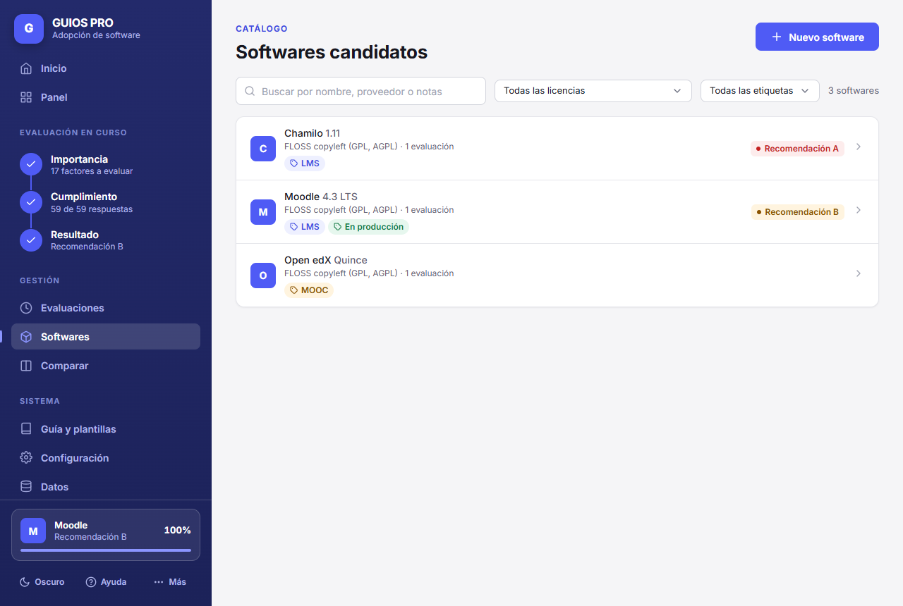
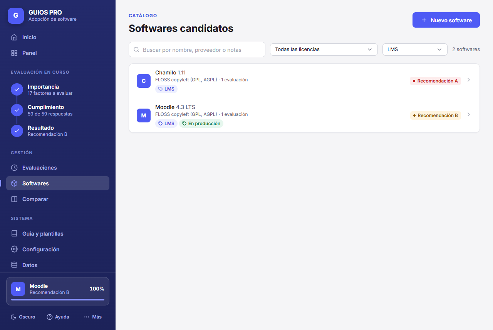
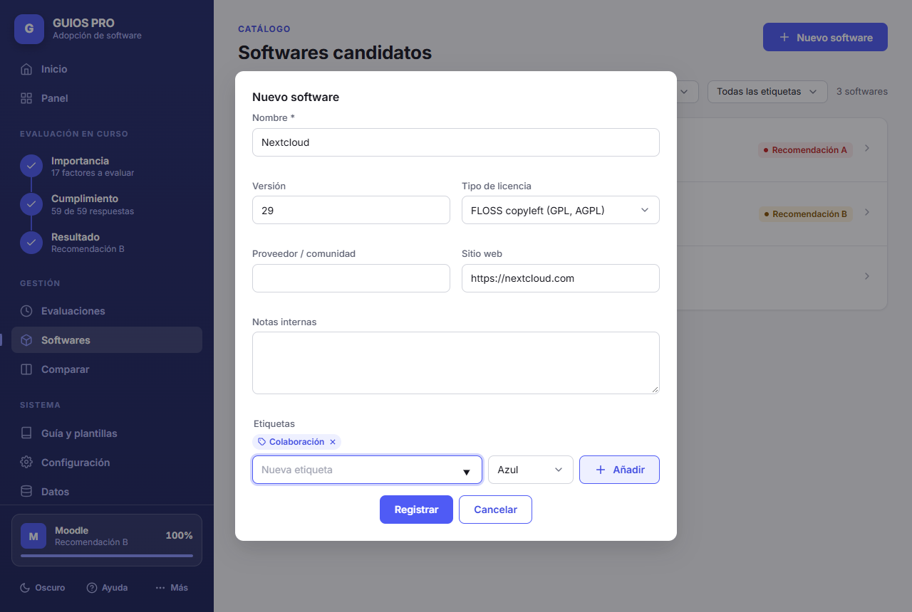
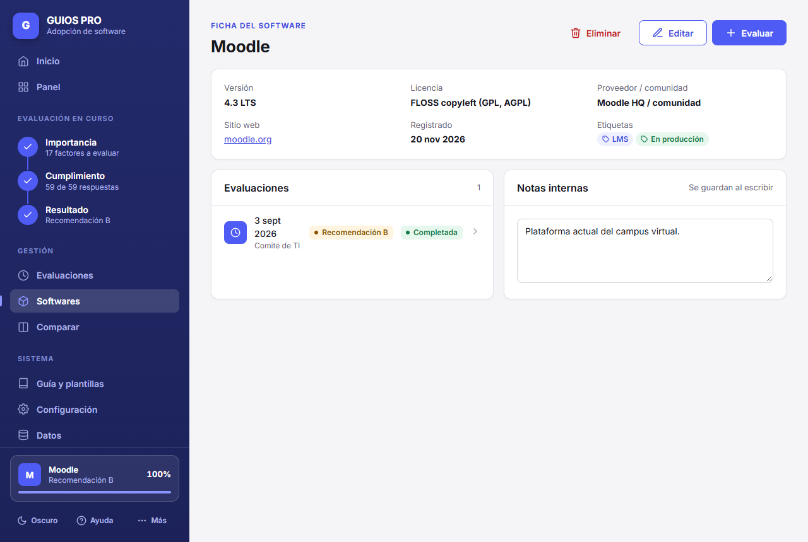
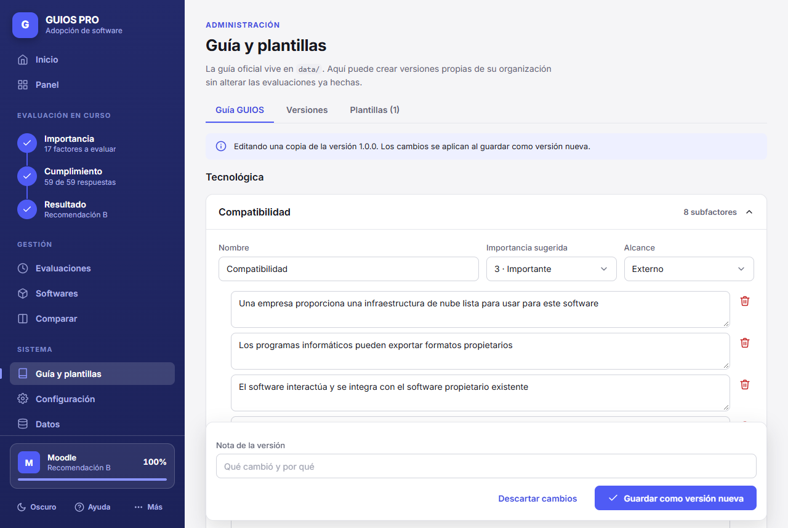
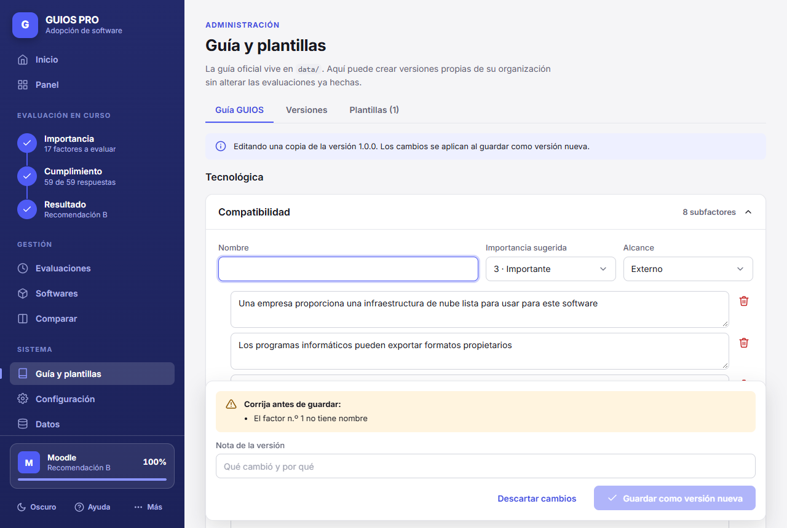
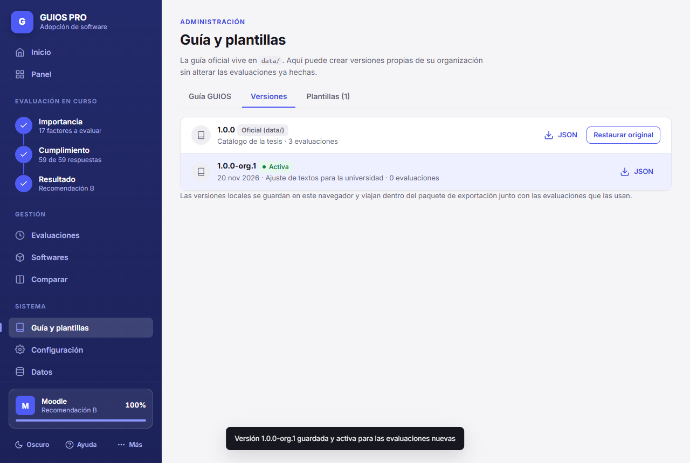
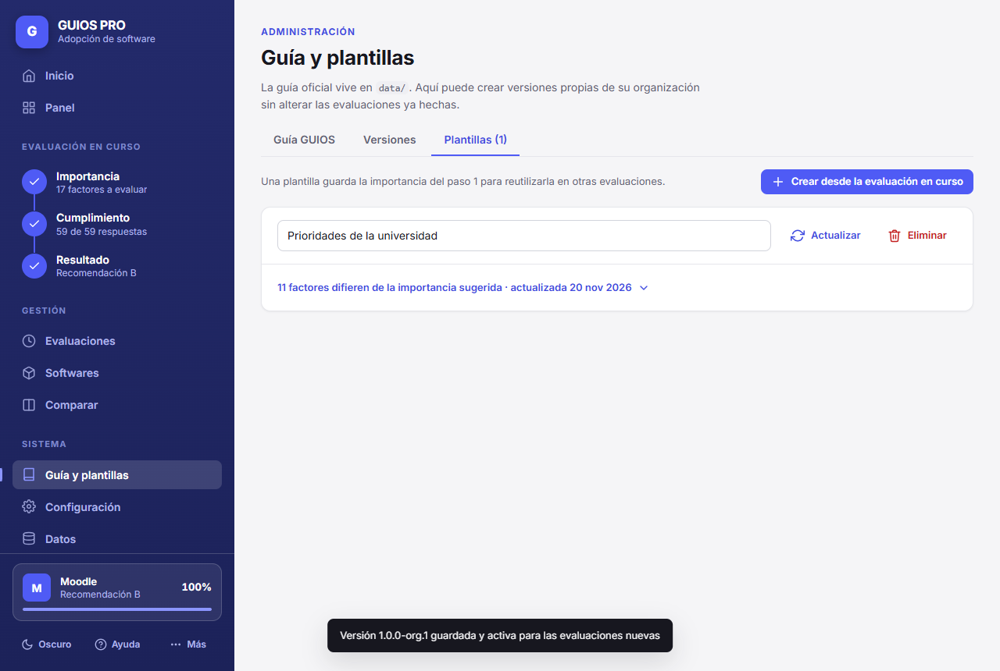
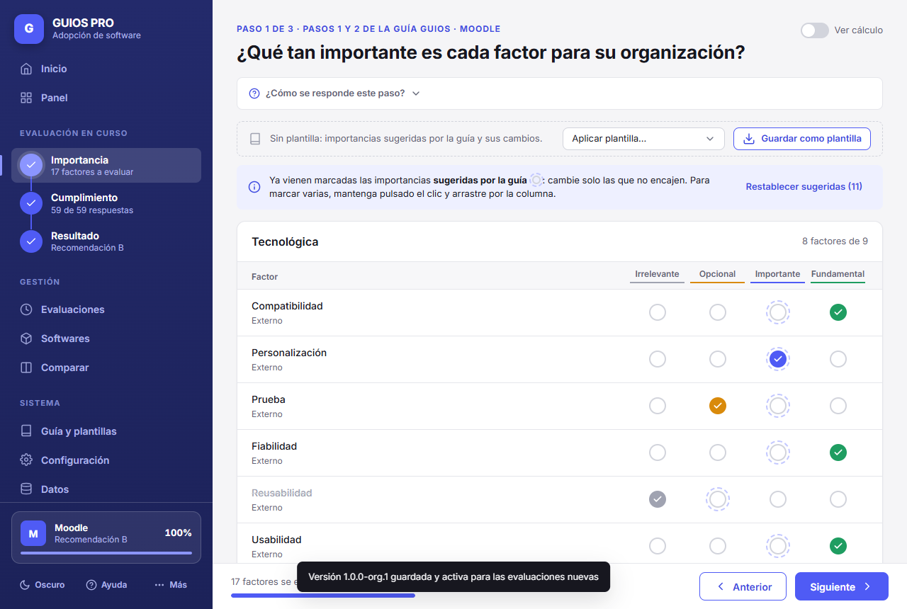

# Manual del catálogo de software y de la administración de la guía

Manual para el responsable del método en GUIOS PRO: la persona que mantiene la lista de softwares candidatos, las versiones de la guía GUIOS que usa la organización y las plantillas de importancia.

Las capturas se tomaron con la evaluación de ejemplo, que se carga desde **Más → Cargar ejemplo** o abriendo `app/index.html?demo=1`.

## 1. Catálogo de softwares

En la barra lateral, **Gestión → Softwares** muestra todos los softwares candidatos de la organización, con su licencia, sus etiquetas, el número de evaluaciones y la recomendación de la última evaluación completada.

Para encontrar un software:

- Escriba en el buscador parte del nombre, del proveedor o de las notas.
- Filtre por tipo de licencia o por etiqueta con los dos desplegables.

### 1.1. Registrar un software

1. Pulse **Nuevo software**.
2. Escriba el nombre, que es obligatorio, y si los tiene, la versión, el tipo de licencia, el proveedor o comunidad y el sitio web. El sitio web debe empezar por `http://` o `https://`.
3. Para añadir una etiqueta, escriba su nombre, elija un color y pulse **Añadir**. Puede añadir varias y quitar cualquiera con su ×.
4. Pulse **Registrar**. Se abre la ficha del software nuevo.

No se permiten dos softwares con el mismo nombre. Si al empezar una evaluación se escribe el nombre de un software que no está en el catálogo, la aplicación lo registra automáticamente al pulsar **Comenzar**.

### 1.2. Ficha, edición y notas

Al pulsar un software en la lista se abre su ficha, con sus datos, sus etiquetas, el historial de evaluaciones y un campo de notas internas que se guarda mientras se escribe.

Desde la ficha:

- **Editar** abre el mismo formulario del alta. Si hay una evaluación en curso de ese software, sus datos se actualizan también.
- **Evaluar** empieza una evaluación nueva de este software.
- **Eliminar** pide confirmación. Si el software tiene evaluaciones, puede elegir borrarlas también; si no lo marca, quedan en el historial sin vincular.

## 2. Administración de la guía GUIOS

**Sistema → Guía y plantillas** tiene tres pestañas: Guía GUIOS, Versiones y Plantillas.

La guía oficial, con 3 dimensiones, 18 factores y 61 subfactores, viene de los archivos de `data/` del repositorio y no se modifica desde aquí. Lo que se hace en esta pantalla es crear **versiones propias de la organización** a partir de ella.

### 2.1. Editar la guía y publicar una versión

1. En la pestaña **Guía GUIOS**, pulse **Editar la guía**. Se edita una copia de la versión activa.
2. Despliegue el factor que quiera cambiar. Puede modificar:
   - el nombre del factor,
   - la importancia sugerida, de 1 Irrelevante a 4 Fundamental,
   - el alcance: Interno, Externo o Ambos,
   - el texto de cada subfactor, quitar subfactores con la papelera o añadir otros con **Añadir subfactor**.
3. Al final de la página puede cambiar el título y el texto de las recomendaciones A, B y C. Las condiciones de la matriz y el umbral FODA no se editan, porque forman parte del método de la guía.
4. Escriba una nota que explique el cambio y pulse **Guardar como versión nueva**.

Mientras edita, la barra inferior muestra los errores que impiden guardar, por ejemplo un factor sin nombre, un subfactor vacío o una importancia fuera de la escala de 1 a 4. El botón de guardar no se activa hasta corregirlos.

Si sale de la pantalla con cambios sin guardar, la aplicación pide confirmación.

### 2.2. Versiones

La pestaña **Versiones** lista la guía oficial y las versiones locales, con su fecha, su nota y cuántas evaluaciones usan cada una. La marcada como **Activa** es la que usarán las evaluaciones nuevas.

- **Activar** hace activa otra versión local.
- **Restaurar original** vuelve a la guía oficial para las evaluaciones nuevas.
- **JSON** descarga esa versión del catálogo.

Cada evaluación conserva la versión con la que se empezó. Por eso cambiar o restaurar la guía nunca altera los resultados de evaluaciones ya hechas.

Las versiones locales viven en el navegador. Para llevarlas a otro equipo, exporte las evaluaciones que las usan desde **Sistema → Datos**: el paquete incluye su versión de la guía. El servidor opcional solo admite evaluaciones hechas con subfactores de la guía oficial.

## 3. Plantillas de importancia

Una plantilla guarda la importancia y el alcance que se asignaron en el paso 1, para reutilizarlos en otras evaluaciones de la organización.

### 3.1. Crear una plantilla

- Desde el paso 1 de una evaluación, pulse **Guardar como plantilla** y escriba un nombre.
- O desde la pestaña **Plantillas**, con **Crear desde la evaluación en curso**.

Si ya existe una plantilla con ese nombre, se actualiza en lugar de crear otra.

### 3.2. Gestionar las plantillas

En la pestaña **Plantillas** cada plantilla muestra cuántos factores difieren de la importancia sugerida por la guía, y su detalle factor a factor.

- Cambie el nombre escribiendo en su campo.
- **Actualizar** la sustituye por la importancia de la evaluación en curso.
- **Eliminar** la borra; las evaluaciones que la usaron no cambian.

### 3.3. Aplicar una plantilla

Al empezar una evaluación, elija la plantilla en **Inicio → Plantilla de importancia**, o en el paso 1 con **Aplicar plantilla…**. La franja superior del paso 1 indica qué plantilla está aplicada.

## 4. Copias de seguridad

Todo lo anterior se guarda en el navegador. Para no perderlo:

- Exporte con regularidad un paquete desde **Sistema → Datos → Exportar**. Incluye softwares, plantillas, evaluaciones y las versiones de la guía que usan.
- Si la organización usa el servidor de GUIOS PRO, actívelo en **Sistema → Configuración**. Los softwares, las plantillas y las evaluaciones se sincronizarán entre equipos.
