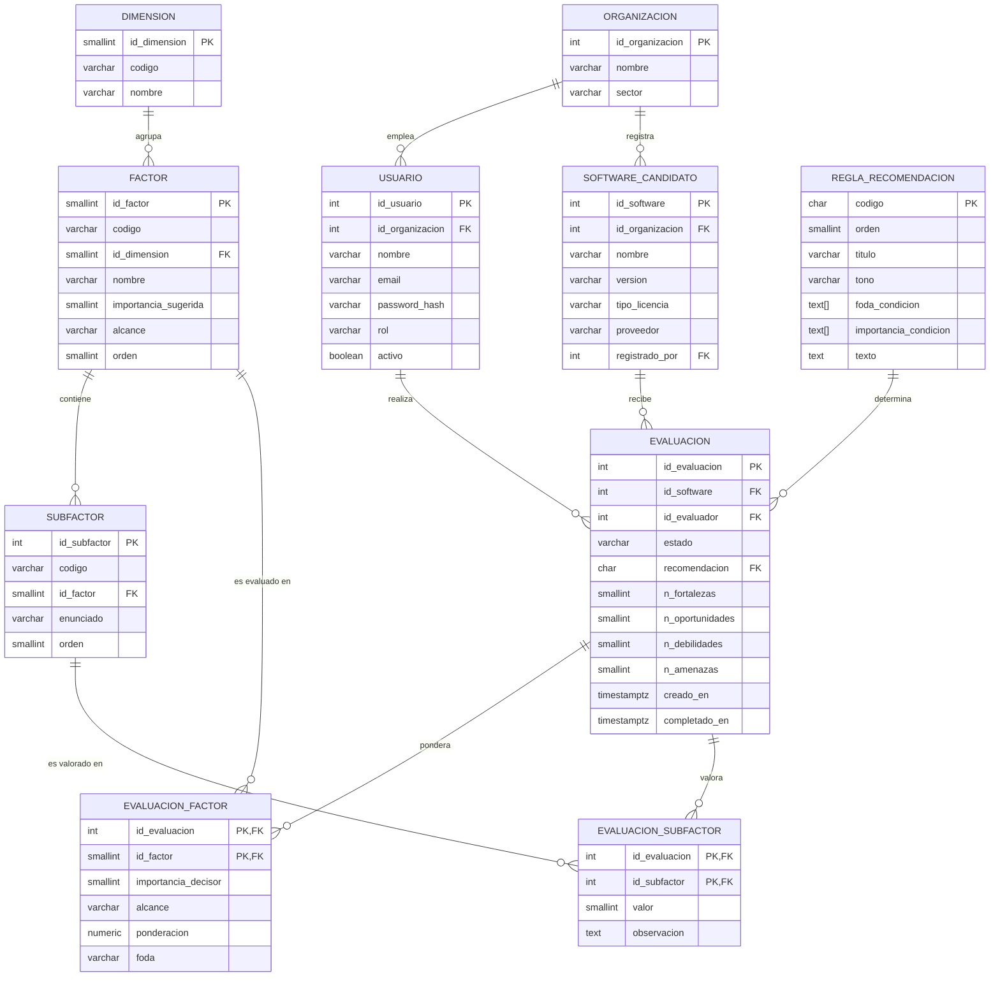

# Sprint 0 — Planificación inicial del proyecto GUIOS PRO

> Base para el informe de avance (S4-TAREA_1). Los datos de este documento están verificados contra el prototipo original (`legacy/`) y los archivos maestros (`data/`): **3 dimensiones, 18 factores, 61 subfactores**, escalas de 4 niveles y matriz de recomendación A/B/C.
>
> Nota: el borrador previo del informe mencionaba "22 factores" y una escala Likert 1-5; ambos datos no corresponden al prototipo GUIOSAD ni a la matriz 2021 y se corrigen aquí.

## 1. Metodología ágil: SCRUM

| Rol | Responsable |
|---|---|
| Product Owner | Docente / autor de la guía (valida el modelo GUIOS) |
| Scrum Master | Estudiante líder del equipo |
| Development Team | Estudiantes del equipo (desarrollo asistido por IA, ver `PLAN-DESARROLLO-IA.md`) |

- Sprints de 2 semanas. Sprint 0 = cimentación (este documento + repositorio + prototipo rediseñado).
- Eventos: Sprint Planning, Daily (asíncrona por chat), Sprint Review con el docente, Retrospectiva.
- Artefactos: Product Backlog (sección 4), Sprint Backlog (issues de GitHub), Incremento (app publicada en GitHub Pages).

**Justificación.** La evaluación de adopción involucra criterios tecnológicos, organizacionales y económicos que cambian según la organización; SCRUM permite validar con el Product Owner cada incremento (pantallas, reglas, reportes) y ajustar el modelo sin rehacer el proyecto.

## 2. Modelado del negocio

### 2.1 ¿Cómo trabaja actualmente el negocio? (AS-IS)

La decisión de adoptar un software (por ejemplo, migrar de una suite privativa a una FLOSS, o incorporar un LMS/ERP) se toma de forma **empírica y no documentada**: el área de TI prueba alternativas, compara costos de licencia y recomienda por criterio personal; la gerencia aprueba según presupuesto. La guía GUIOS existe como documento y como un prototipo de escritorio (GUIOSAD v0.1.2, Python/Flexx) que:

- Se ejecuta desde PyCharm y exporta un HTML de una sola sesión, sin guardar resultados.
- Presenta los 6 pasos en 3 pestañas con controles deslizantes, sin validaciones ni ayuda contextual.
- No registra qué software se evalúa, quién evalúa ni cuándo; no genera informes.
- Su código mezcla lógica y presentación (ver `legacy/main.py`), lo que dificulta el mantenimiento.

### 2.2 ¿Quiénes participan?

| Actor | Rol en el proceso |
|---|---|
| **Decisor** (gerencia / dirección de TI) | Fija la importancia de cada factor para la organización (Paso 1) y toma la decisión final (Paso 6). |
| **Evaluador técnico** (analista de TI) | Valora el cumplimiento de cada subfactor por parte del software candidato (Paso 3). |
| **Administrador del sistema** | Gestiona usuarios, organizaciones y el catálogo de la guía. |
| **Usuarios finales / áreas** | Aportan información sobre formación, resistencia al cambio, soporte. |
| **Comunidad / proveedor del software** | Fuente externa de información (documentación, soporte, casos de éxito). |

### 2.3 ¿Qué problemas existen?

1. No hay un procedimiento estándar: cada evaluación parte de cero y no es comparable con otras.
2. Sesgo y subjetividad: se ponderan factores de forma implícita, sin distinguir alcance interno/externo.
3. El prototipo actual no persiste datos ni genera evidencia para el comité.
4. Costos ocultos y bloqueo de proveedores se detectan tarde.
5. Se ignoran factores organizacionales (formación, apoyo de la alta dirección, actitud al cambio).

### 2.4 ¿Qué procesos se automatizarán? — Alcance inicial

| # | Proceso | Estado en Sprint 0 |
|---|---|---|
| P1 | Registro del software candidato y de la organización | Hecho (formulario, persistencia local) |
| P2 | Paso 1-2: importancia sugerida vs. decisor → importancia relativa y relevancia; alcance | Hecho |
| P3 | Paso 3-4: valoración de subfactores → ponderación del factor | Hecho |
| P4 | Paso 5: clasificación FODA automática | Hecho |
| P5 | Paso 6: recomendación A/B/C según matriz + factores críticos | Hecho |
| P6 | Informe exportable (PDF por impresión, JSON) e importación | Hecho |
| P7 | Usuarios, roles y evaluaciones guardadas en servidor (PostgreSQL) | Diseñado (`db/schema.sql`), Sprint 2-3 |
| P8 | Comparación de varios candidatos y panel del decisor | Sprint 4 |

### 2.5 ¿Cómo mejorará el nuevo sistema? — Propuesta (TO-BE)

```
AS-IS                                        TO-BE (GUIOS PRO)
─────────────────────────────────────────    ─────────────────────────────────────────────
Evaluación empírica, sin criterios comunes → Guía de 6 pasos con 18 factores y 61 subfactores
Prototipo de escritorio, requiere PyCharm  → App web portable (doble clic) y publicable (Pages)
Sin persistencia ni trazabilidad           → Estado guardado, exportación/importación JSON,
                                             BD PostgreSQL con historial (Sprint 2-3)
Resultados en cajas de texto               → Matriz FODA, KPIs por dimensión, informe PDF
Lógica acoplada a la interfaz              → Motor de cálculo independiente y probado
Interfaz sin guía                          → UI kit consistente, responsive y accesible
```

## 3. Ingeniería de requisitos

### 3.1 Requisitos funcionales

| ID | Requisito | Prioridad | Sprint |
|---|---|---|---|
| RF-01 | Registrar el software candidato (nombre, versión, licencia, proveedor) y la organización/evaluador. | Alta | 0 ✔ |
| RF-02 | Mostrar los 18 factores agrupados por dimensión con su importancia sugerida y permitir al decisor asignar la propia (4 niveles). | Alta | 0 ✔ |
| RF-03 | Calcular la importancia relativa y marcar como no relevantes los factores *Irrelevantes*. | Alta | 0 ✔ |
| RF-04 | Permitir elegir el alcance (Interno/Externo) de los factores con alcance "Ambos". | Alta | 0 ✔ |
| RF-05 | Valorar cada subfactor de los factores relevantes (4 niveles) y calcular la ponderación media. | Alta | 0 ✔ |
| RF-06 | Clasificar cada factor evaluado en la matriz FODA según alcance y umbral. | Alta | 0 ✔ |
| RF-07 | Emitir la recomendación A/B/C con el texto de la matriz e indicar los factores críticos. | Alta | 0 ✔ |
| RF-08 | Exportar el informe (PDF) y los datos (JSON); importar una evaluación previa. | Media | 0 ✔ |
| RF-09 | Guardar el avance automáticamente y permitir reiniciar la evaluación con confirmación. | Media | 0 ✔ |
| RF-10 | Autenticación con roles Administrador / Evaluador / Decisor. | Alta | 2 |
| RF-11 | Persistir evaluaciones en servidor con historial por organización. | Alta | 2-3 |
| RF-12 | Administrar el catálogo (factores, subfactores, reglas) desde la interfaz. | Media | 3 |
| RF-13 | Comparar varias evaluaciones/candidatos en un tablero. | Media | 4 |
| RF-14 | Adjuntar observaciones/evidencias por subfactor. | Baja | 4 |

### 3.2 Requisitos no funcionales

| ID | Requisito |
|---|---|
| RNF-01 Usabilidad | Interfaz coherente con el UI kit; cualquier paso accesible en ≤ 3 clics; textos de ayuda en cada paso. |
| RNF-02 Portabilidad | Funciona en Chrome, Edge y Firefox actuales; abre desde `file://` sin instalación; responsive desde 390 px. |
| RNF-03 Rendimiento | Recalcular FODA y recomendación en < 100 ms en el navegador (61 subfactores). |
| RNF-04 Accesibilidad | Controles etiquetados, foco visible, contraste AA, navegación por teclado. |
| RNF-05 Mantenibilidad | Datos maestros en archivos versionados; lógica separada de la UI; pruebas automatizadas en CI. |
| RNF-06 Seguridad (Sprint 2+) | Contraseñas con bcrypt/argon2, HTTPS, validación de entrada, protección CSRF/XSS. |
| RNF-07 Disponibilidad (Sprint 2+) | ≥ 99 % mensual en el despliegue institucional. |
| RNF-08 Trazabilidad | Cada evaluación registra evaluador, fecha y versión del catálogo. |

### 3.3 Product Backlog inicial

| ID | Historia de usuario | Criterios de aceptación | Prioridad | Puntos | Sprint |
|---|---|---|---|---|---|
| HU-01 | Como evaluador quiero registrar el software candidato para identificar la evaluación. | Formulario con nombre, versión, licencia, proveedor, organización, evaluador; se guarda automáticamente. | Alta | 2 | 0 ✔ |
| HU-02 | Como decisor quiero fijar la importancia de cada factor para adaptar la guía a mi organización. | Tabla por dimensión; dropdown de 4 niveles; importancia relativa calculada al instante; factores irrelevantes atenuados. | Alta | 5 | 0 ✔ |
| HU-03 | Como decisor quiero indicar si un factor "Ambos" es interno o externo. | Control segmentado Interno/Externo solo en factores con alcance "Ambos" (Soporte). | Alta | 2 | 0 ✔ |
| HU-04 | Como evaluador quiero valorar los subfactores de cada factor relevante. | Lista lateral con progreso n/N por factor; dropdown de 4 niveles por subfactor; ponderación visible al completar. | Alta | 5 | 0 ✔ |
| HU-05 | Como decisor quiero ver la matriz FODA y la recomendación para decidir. | KPIs F/O/D/A, cuadrantes con factores y ponderación, tarjeta de recomendación A/B/C con factores críticos, tabla detallada. | Alta | 8 | 0 ✔ |
| HU-06 | Como decisor quiero exportar el informe para presentarlo al comité. | Botón Exportar PDF (impresión con cabecera del informe) y JSON; importar JSON restaura la evaluación. | Media | 3 | 0 ✔ |
| HU-07 | Como usuario quiero que mi avance no se pierda al cerrar el navegador. | Estado en localStorage; reinicio con pop-up de confirmación. | Media | 2 | 0 ✔ |
| HU-08 | Como administrador quiero gestionar usuarios y roles. | CRUD de usuarios, roles Administrador/Evaluador/Decisor, contraseñas cifradas. | Alta | 5 | 2 |
| HU-09 | Como evaluador quiero guardar evaluaciones en el servidor y consultarlas después. | API REST + PostgreSQL (`db/schema.sql`); listado por organización; estados En proceso/Completada. | Alta | 8 | 2-3 |
| HU-10 | Como administrador quiero editar el catálogo de factores y reglas. | Pantalla de administración; cambios versionados; validación de escalas. | Media | 5 | 3 |
| HU-11 | Como decisor quiero comparar candidatos. | Tablero con varias evaluaciones y sus recomendaciones. | Media | 5 | 4 |
| HU-12 | Como evaluador quiero adjuntar evidencias por subfactor. | Campo de observación y enlace por subfactor; aparece en el informe. | Baja | 3 | 4 |

Velocidad estimada: 13-15 puntos por sprint.

## 4. Análisis y diseño

### 4.1 Modelo conceptual

- **DIMENSION** (1) — (N) **FACTOR** (1) — (N) **SUBFACTOR**: catálogo de la guía.
- **ORGANIZACION** (1) — (N) **USUARIO**; **ORGANIZACION** (1) — (N) **SOFTWARE_CANDIDATO**.
- **SOFTWARE_CANDIDATO** (1) — (N) **EVALUACION** (N) — (1) **USUARIO** (evaluador).
- **EVALUACION** (1) — (N) **EVALUACION_FACTOR** (importancia del decisor, alcance, ponderación, FODA).
- **EVALUACION** (1) — (N) **EVALUACION_SUBFACTOR** (valor 1..4, observación).
- **REGLA_RECOMENDACION** (A/B/C) referenciada por **EVALUACION**.

### 4.2 Modelo lógico (diagrama ER)



Para el informe: renderizar este diagrama (Mermaid Live Editor o la extensión de VS Code) y exportarlo a PNG/SVG a 300 DPI.

### 4.3 Diseño físico

- Script DDL completo: [`db/schema.sql`](../db/schema.sql) (PostgreSQL 14+, claves foráneas, restricciones CHECK sobre escalas 1..4, vista `v_evaluacion_factor` con la importancia relativa).
- Datos maestros: [`db/seed.sql`](../db/seed.sql), generado automáticamente desde `data/` con `npm run build:data`.
- Decisiones: las escalas se modelan como tablas (`nivel_importancia`, `nivel_cumplimiento`) para garantizar integridad; los resultados agregados de `evaluacion` se recalculan al completar (la fuente de verdad es el detalle); `regla_recomendacion` guarda las condiciones como arreglos para que el motor las evalúe en orden, igual que `engine.js`.

## 5. Arquitectura (Sprint 0 y evolución)

```
Sprint 0-1 (actual)                Sprint 2-3                          Sprint 4+
┌──────────────────────┐          ┌──────────────────────┐            ┌──────────────────────┐
│ app/ (HTML/CSS/JS)   │          │ app/ (misma UI)      │            │ Tablero comparativo   │
│ engine.js (cálculo)  │  ─────▶  │ api/ FastAPI o Node  │  ─────▶    │ Admin de catálogo     │
│ localStorage         │          │ PostgreSQL (db/)     │            │ Evidencias / adjuntos │
│ GitHub Pages         │          │ Docker Compose       │            │                       │
└──────────────────────┘          └──────────────────────┘            └──────────────────────┘
```

El motor de cálculo se conserva idéntico en ambas capas (JS en el navegador; en el servidor se reimplementa contra `v_evaluacion_factor` o se ejecuta el mismo `engine.js` en Node), garantizando resultados consistentes.
