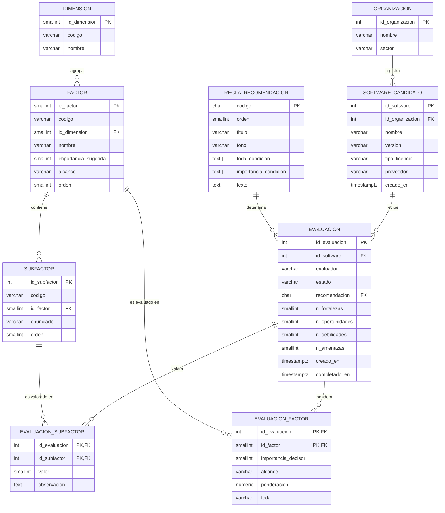

# Sprint 0 — Planificación inicial del proyecto GUIOS PRO

> Base para el informe de avance (S4-TAREA_1). Los datos están verificados contra la tesis doctoral de referencia (Rea Sánchez, 2022), el prototipo original (`legacy/`) y los archivos maestros (`data/`).
>
> **Precisión sobre el número de factores:** la revisión sistemática de la literatura identificó **22 factores**, pero la guía GUIOS excluyó 4 al no encontrarles ningún subfactor (*Reingeniería de procesos empresariales*, *Coste de licencia*, *Coste operacional* y *Coste de soporte*, estos tres absorbidos por *Coste total de propiedad*). Por tanto la guía y la herramienta operan con **3 dimensiones, 18 factores y 61 subfactores**, y con escalas discretas de **4 niveles** (no Likert 1-5). Ambas cifras son correctas según el contexto en que se citen.
>
> Las dudas abiertas sobre el modelo (nomenclatura A/B/C, dos importancias sugeridas en disputa y criterio de decisión) están recogidas en [`REUNION-DOCENTE.md`](REUNION-DOCENTE.md) para consultarlas con el Product Owner.

## 1. Metodología ágil: SCRUM

| Rol | Responsable |
|---|---|
| Product Owner | Docente / autor de la guía (valida el modelo GUIOS) |
| Scrum Master | Estudiante líder del equipo |
| Development Team | Estudiantes del equipo (desarrollo asistido por IA, ver `PLAN-DESARROLLO-IA.md`) |

- Sprints de 2 semanas. Sprint 0 = cimentación (este documento + repositorio + prototipo rediseñado).
- Eventos: Sprint Planning, Daily (asíncrona por chat), Sprint Review con el docente, Retrospectiva.
- Artefactos: Product Backlog (sección 4), Sprint Backlog (issues de GitHub), Incremento (app publicada en GitHub Pages).

**Justificación.** La evaluación de adopción involucra criterios tecnológicos, organizacionales y económicos que cambian según la organización; SCRUM permite validar con el Product Owner cada incremento (pantallas, reglas, reportes) y ajustar el modelo sin rehacer el proyecto.

## 2. Modelado del negocio

### 2.1 ¿Cómo trabaja actualmente el negocio? (AS-IS)

La decisión de adoptar un software (por ejemplo, migrar de una suite privativa a una FLOSS, o incorporar un LMS/ERP) se toma de forma **empírica y no documentada**: el área de TI prueba alternativas, compara costos de licencia y recomienda por criterio personal; la gerencia aprueba según presupuesto. La guía GUIOS existe como documento y como un prototipo de escritorio (GUIOSAD v0.1.2, Python/Flexx) que:

- Se ejecuta desde PyCharm y exporta un HTML de una sola sesión, sin guardar resultados.
- Presenta los 6 pasos en 3 pestañas con controles deslizantes, sin validaciones ni ayuda contextual.
- No registra qué software se evalúa, quién evalúa ni cuándo; no genera informes.
- Su código mezcla lógica y presentación (ver `legacy/main.py`), lo que dificulta el mantenimiento.

### 2.2 ¿Quiénes participan?

| Actor | Rol en el proceso |
|---|---|
| **Decisor** (gerencia / dirección de TI) | Fija la importancia de cada factor para la organización (Paso 1) y toma la decisión final (Paso 6). |
| **Evaluador técnico** (analista de TI) | Valora el cumplimiento de cada subfactor por parte del software candidato (Paso 3). |
| **Responsable del método** | Mantiene el catálogo de la guía (factores, subfactores y reglas) y los softwares candidatos registrados. |
| **Usuarios finales / áreas** | Aportan información sobre formación, resistencia al cambio, soporte. |
| **Comunidad / proveedor del software** | Fuente externa de información (documentación, soporte, casos de éxito). |

### 2.3 ¿Qué problemas existen?

1. No hay un procedimiento estándar: cada evaluación parte de cero y no es comparable con otras.
2. Sesgo y subjetividad: se ponderan factores de forma implícita, sin distinguir alcance interno/externo.
3. El prototipo actual no persiste datos ni genera evidencia para el comité.
4. Costos ocultos y bloqueo de proveedores se detectan tarde.
5. Se ignoran factores organizacionales (formación, apoyo de la alta dirección, actitud al cambio).

### 2.4 ¿Qué procesos se automatizarán? — Alcance inicial

| # | Proceso | Estado en Sprint 0 |
|---|---|---|
| P1 | Registro del software candidato y de la organización | Hecho (formulario, persistencia local) |
| P2 | Paso 1-2: importancia sugerida vs. decisor → importancia relativa y relevancia; alcance | Hecho |
| P3 | Paso 3-4: valoración de subfactores → ponderación del factor | Hecho |
| P4 | Paso 5: clasificación FODA automática | Hecho |
| P5 | Paso 6: recomendación A/B/C según matriz + factores críticos | Hecho |
| P6 | Informe exportable (PDF por impresión, JSON) e importación | Hecho |
| P7 | Catálogo de software y evaluaciones guardadas en servidor | Hecho: catálogo local y servidor `api/` (SQLite; diseño PostgreSQL en `db/schema.sql`) |
| P8 | Comparación de varios candidatos y panel del decisor | Hecho |

### 2.5 ¿Cómo mejorará el nuevo sistema? — Propuesta (TO-BE)

```
AS-IS                                        TO-BE (GUIOS PRO)
─────────────────────────────────────────    ─────────────────────────────────────────────
Evaluación empírica, sin criterios comunes → Guía de 6 pasos con 18 factores y 61 subfactores
Prototipo de escritorio, requiere PyCharm  → App web portable (doble clic) y publicable (Pages)
Sin persistencia ni trazabilidad           → Estado guardado, exportación/importación JSON,
                                             BD PostgreSQL con historial (Sprint 2-3)
Resultados en cajas de texto               → Matriz FODA, KPIs por dimensión, informe PDF
Lógica acoplada a la interfaz              → Motor de cálculo independiente y probado
Interfaz sin guía                          → UI kit consistente, responsive y accesible
```

## 3. Ingeniería de requisitos

### 3.1 Requisitos funcionales

| ID | Requisito | Prioridad | Sprint |
|---|---|---|---|
| RF-01 | Registrar el software candidato (nombre, versión, licencia, proveedor) y la organización/evaluador. | Alta | 0 ✔ |
| RF-02 | Mostrar los 18 factores agrupados por dimensión con su importancia sugerida y permitir al decisor asignar la propia (4 niveles). | Alta | 0 ✔ |
| RF-03 | Calcular la importancia relativa y marcar como no relevantes los factores *Irrelevantes*. | Alta | 0 ✔ |
| RF-04 | Permitir elegir el alcance (Interno/Externo) de los factores con alcance "Ambos". | Alta | 0 ✔ |
| RF-05 | Valorar cada subfactor de los factores relevantes (4 niveles) y calcular la ponderación media. | Alta | 0 ✔ |
| RF-06 | Clasificar cada factor evaluado en la matriz FODA según alcance y umbral. | Alta | 0 ✔ |
| RF-07 | Emitir la recomendación A/B/C con el texto de la matriz e indicar los factores críticos. | Alta | 0 ✔ |
| RF-08 | Exportar el informe (PDF) y los datos (JSON); importar una evaluación previa. | Media | 0 ✔ |
| RF-09 | Guardar el avance automáticamente y permitir limpiar los datos de una evaluación anterior, con confirmación. | Media | 0 ✔ |
| RF-10 | Persistir evaluaciones en un servidor con historial por organización. | Alta | 2-3 ✔ |
| RF-11 | Registrar y consultar los softwares candidatos en un catálogo reutilizable. | Alta | 2 ✔ |
| RF-12 | Administrar el catálogo de la guía (factores, subfactores, reglas) desde la interfaz. | Media | 3 ✔ |
| RF-13 | Comparar varias evaluaciones/candidatos en un tablero. | Media | 4 ✔ |
| RF-14 | Adjuntar observaciones/evidencias por subfactor. | Baja | 4 ✔ |
| RF-15 | Navegar libremente entre los pasos y ver el detalle del cálculo de cada resultado. | Alta | 0 ✔ |
| RF-16 | Guardar los datos de la organización y las preferencias del usuario una sola vez. | Alta | 1 ✔ |
| RF-17 | Mostrar ayuda contextual en cada paso, incluido el significado de cada nivel de la escala. | Alta | 1 ✔ |
| RF-18 | Avisar de los factores sin responder y marcar el resultado como parcial. | Alta | 1 ✔ |
| RF-19 | Buscar factores por nombre y filtrar los que están pendientes. | Media | 1 ✔ |
| RF-20 | Mostrar un dashboard con el estado de las evaluaciones, el avance, la distribución FODA y el cumplimiento por dimensión. | Alta | 1, 4 ✔ |
| RF-21 | Listar las evaluaciones propias, con opciones de continuar, duplicar, eliminar y abrir en solo lectura. | Alta | 2, 4 ✔ |
| RF-22 | Mostrar gráficos de resultados: radar por dimensión y barras de la matriz FODA. | Alta | 2 ✔ |
| RF-23 | Generar un informe imprimible con portada, recomendación, FODA, gráficos y detalle por factor. | Media | 2, 5 ✔ |
| RF-24 | Mostrar la línea de tiempo de las evaluaciones de un software. | Media | 3 ✔ |
| RF-25 | Guardar y reutilizar plantillas de importancia de factores. | Media | 3 ✔ |
| RF-26 | Importar y exportar softwares, plantillas y evaluaciones. | Media | 4 ✔ |
| RF-27 | Asignar etiquetas y notas internas a cada software del catálogo. | Baja | 4 ✔ |
| RF-28 | Sugerir con IA la valoración de cada subfactor, con justificación y nivel de confianza; el evaluador acepta o descarta cada sugerencia. | Alta | 2-3 ✔ |
| RF-29 | Generar con IA un resumen ejecutivo editable que no contradiga la recomendación calculada. | Alta | 4 ✔ |
| RF-30 | Sincronizar las evaluaciones locales con el servidor y resolver conflictos entre versiones. | Alta | 3 ✔ |

### 3.2 Requisitos no funcionales

| ID | Requisito |
|---|---|
| RNF-01 Usabilidad | Interfaz coherente con el UI kit; cualquier paso accesible en ≤ 3 clics; textos de ayuda en cada paso. |
| RNF-02 Portabilidad | Funciona en Chrome, Edge y Firefox actuales; abre desde `file://` sin instalación; responsive desde 390 px. |
| RNF-03 Rendimiento | Recalcular FODA y recomendación en < 100 ms en el navegador (61 subfactores). |
| RNF-04 Accesibilidad | Controles etiquetados, foco visible, contraste AA, navegación por teclado. |
| RNF-05 Mantenibilidad | Datos maestros en archivos versionados; lógica separada de la UI; pruebas automatizadas en CI. |
| RNF-06 Seguridad (Sprint 2+) | HTTPS, validación de toda la entrada y protección ante inyección SQL y XSS. La clave del servicio de IA solo existe en el servidor. |
| RNF-07 Disponibilidad (Sprint 2+) | ≥ 99 % mensual en el despliegue institucional. |
| RNF-08 Trazabilidad | Cada evaluación registra el evaluador indicado, la fecha y la versión del catálogo. |
| RNF-09 Rendimiento web | Lighthouse de rendimiento y accesibilidad igual o mayor a 90 en las pantallas principales. |
| RNF-10 Rendimiento del servidor | Los indicadores del dashboard se devuelven en menos de 300 ms con los datos de prueba. |
| RNF-11 Fiabilidad del cálculo | El servidor y el navegador deben dar resultados idénticos de ponderación, FODA y recomendación; cualquier diferencia rompe la integración continua. |
| RNF-12 Resiliencia | Sin servidor disponible, la aplicación sigue funcionando con los datos locales; la sincronización nunca pierde respuestas en silencio. |
| RNF-13 Control humano de la IA | Ninguna sugerencia de la IA se guarda sin aceptación del evaluador; el contenido generado con IA se marca como tal en el informe; la recomendación final siempre sale del cálculo de GUIOS, nunca del modelo. |
| RNF-14 Disponibilidad y costo de la IA | Si no hay IA disponible o configurada, la aplicación funciona igual en modo manual; el consumo del servicio de IA tiene un límite configurable por organización. |
| RNF-15 Calidad de la IA | Las sugerencias y el resumen ejecutivo se miden con al menos 30 casos de referencia y un umbral mínimo de acierto acordado por el equipo. |
| RNF-16 Privacidad | La política de tratamiento de datos con el proveedor de IA queda definida por escrito antes de usarlo, y la clave del servicio nunca se expone en el navegador. |
| RNF-17 Integridad histórica | Los cambios al catálogo de la guía se versionan y no alteran las evaluaciones ya completadas. |

### 3.3 Product Backlog inicial

> **Versión vigente y ampliada:** la lista completa de requisitos (RF-01 a RF-26), el backlog con las 36 historias y su trazabilidad están en [`ENTREGA-TAREA1.md`](ENTREGA-TAREA1.md), que es el documento que se entrega. La tabla siguiente conserva el backlog inicial del Sprint 0. Las filas HU-14 en adelante se añadieron desde la rama `requisitos` con la numeración anterior a la renumeración del 27/09/2026 (ver §3.5); para los identificadores vigentes, usar `ENTREGA-TAREA1.md` y `jira/tareas.json`.

| ID | Historia de usuario | Criterios de aceptación | Prioridad | Puntos | Sprint |
|---|---|---|---|---|---|
| HU-01 | Como evaluador quiero registrar el software candidato para identificar la evaluación. | Formulario con nombre, versión, licencia, proveedor, organización, evaluador; se guarda automáticamente. | Alta | 2 | 0 ✔ |
| HU-02 | Como decisor quiero fijar la importancia de cada factor para adaptar la guía a mi organización. | Tabla por dimensión; dropdown de 4 niveles; importancia relativa calculada al instante; factores irrelevantes atenuados. | Alta | 5 | 0 ✔ |
| HU-03 | Como decisor quiero indicar si un factor "Ambos" es interno o externo. | Control segmentado Interno/Externo solo en factores con alcance "Ambos" (Soporte). | Alta | 2 | 0 ✔ |
| HU-04 | Como evaluador quiero valorar los subfactores de cada factor relevante. | Lista lateral con progreso n/N por factor; dropdown de 4 niveles por subfactor; ponderación visible al completar. | Alta | 5 | 0 ✔ |
| HU-05 | Como decisor quiero ver la matriz FODA y la recomendación para decidir. | KPIs F/O/D/A, cuadrantes con factores y ponderación, tarjeta de recomendación A/B/C con factores críticos, tabla detallada. | Alta | 8 | 0 ✔ |
| HU-06 | Como decisor quiero exportar el informe para presentarlo al comité. | Botón Exportar PDF (impresión con cabecera del informe) y JSON; importar JSON restaura la evaluación. | Media | 3 | 0 ✔ |
| HU-07 | Como usuario quiero que mi avance no se pierda al cerrar el navegador y poder empezar de cero cuando cambie de proyecto. | Estado en localStorage; botón «Limpiar datos» en Inicio y en el menú ⋯, con pop-up de confirmación. | Media | 2 | 0 ✔ |
| HU-13 | Como usuario quiero una interfaz simple, con modo oscuro y navegación clara. | Tres pasos con lenguaje llano; detalle de cálculo oculto tras "Ver cálculo"/secciones plegables; botón de tema; barra lateral con los pasos uno a uno y secciones futuras (Historial, Administración). | Media | 3 | 0 ✔ |
| HU-08 | Como evaluador quiero un catálogo de softwares candidatos para no repetir sus datos en cada evaluación. | Lista con buscador, alta, edición y ficha de detalle con las evaluaciones asociadas. | Alta | 8 | 2 |
| HU-09 | Como evaluador quiero guardar evaluaciones en el servidor y consultarlas después. | API REST + PostgreSQL (`db/schema.sql`); listado con filtros; estados En proceso/Completada. | Alta | 8 | 2-3 |
| HU-10 | Como administrador quiero editar el catálogo de factores y reglas. | Pantalla de administración; cambios versionados; validación de escalas. | Media | 5 | 3 |
| HU-11 | Como decisor quiero comparar candidatos. | Tablero con varias evaluaciones y sus recomendaciones. | Media | 5 | 4 |
| HU-12 | Como evaluador quiero adjuntar evidencias por subfactor. | Campo de observación y enlace por subfactor; aparece en el informe. | Baja | 3 | 4 |
| HU-14 | Como evaluador quiero entender qué significa cada nivel de la escala para responder con criterio. | Cada paso muestra una ayuda breve plegable; el paso 2 explica los 4 niveles de cumplimiento; los textos provienen de data/ y no se duplican en el código. | Alta | 3 | 1 |
| HU-15 | Como evaluador quiero que el sistema me avise si dejo factores sin responder antes de ver el resultado. | Al pasar al paso 3 con pendientes se muestra un aviso con la lista de factores y un enlace directo a cada uno; el resultado se marca como parcial. | Alta | 3 | 1 |
| HU-23 | Como desarrollador del frontend quiero obtener dimensiones, factores y subfactores desde la API para no depender del archivo generado. | GET de dimensiones, factores y subfactores con sus escalas; respuesta con la misma forma que app/js/data.js; documentado en OpenAPI. | Media | 3 | 1 |
| HU-24 | Como usuario quiero guardar los datos de mi organización y mis preferencias una sola vez para no repetirlos en cada evaluación. | Pantalla de Configuración con nombre, sector y logo de la organización, evaluador por defecto y tema; confirmación antes de salir sin guardar; los datos se reutilizan al crear una evaluación. | Alta | 5 | 1 |
| HU-25 | Como evaluador quiero buscar un factor y filtrar los que me faltan para avanzar más rápido en evaluaciones largas. | Campo de búsqueda por nombre de factor o texto del subfactor, filtro «solo pendientes» y contador de resultados; funciona con teclado y en móvil. | Media | 5 | 1 |
| HU-26 | Como decisor quiero una pantalla de inicio con el estado general de mis evaluaciones para saber de un vistazo en qué punto estoy. | Dashboard con evaluaciones y su estado, avance de la evaluación en curso, distribución FODA, cumplimiento medio por dimensión y accesos directos; estado vacío cuando no hay evaluaciones. | Alta | 8 | 1 |
| HU-16 | Como evaluador quiero que el sistema me proponga una valoración para cada subfactor a partir de la información del software, para acelerar la evaluación sin perder criterio. | Devuelve valor 1..4, justificación breve y nivel de confianza por subfactor; validación estricta del JSON; la sugerencia nunca se guarda sin aceptación del evaluador. | Alta | 8 | 2 |
| HU-17 | Como evaluador quiero registrar y consultar los softwares candidatos de mi organización. | Crear, listar, editar y eliminar con validación; filtrado por la organización configurada; documentado en OpenAPI y con pruebas de los casos de error. | Alta | 5 | 2 |
| HU-18 | Como evaluador quiero registrar en un solo lugar los softwares que evalúo para no volver a escribir sus datos en cada evaluación. | Pantalla con lista, buscador y filtro por tipo de licencia; alta, edición y eliminación con confirmación; al crear una evaluación se elige un software del catálogo; estado vacío con acción de alta. | Alta | 8 | 2 |
| HU-22 | Como decisor quiero ver gráficos que resuman el cumplimiento por dimensión y la matriz FODA. | Gráfico radar por dimensión y barras de FODA legibles en tema claro, oscuro e impresión, con tabla equivalente para lectores de pantalla. | Alta | 5 | 2 |
| HU-27 | Como evaluador quiero ver todas mis evaluaciones en una lista para continuar la que quiera o empezar una nueva. | Lista con software, fecha, estado, avance y recomendación; acciones continuar, duplicar y eliminar con confirmación; buscador y estado vacío. | Alta | 5 | 2 |
| HU-28 | Como decisor quiero una vista de informe completa y ordenada para presentarla al comité. | Informe con portada, datos del software, recomendación, FODA, gráficos y detalle por factor; se exporta a PDF sin cortes dentro de una tarjeta y en un máximo de 3 páginas. | Media | 5 | 2 |
| HU-36 | Como evaluador quiero ver la ficha de un software con sus datos y las evaluaciones que se le han hecho. | Vista de detalle con datos del software, historial de evaluaciones asociadas con su recomendación, y accesos a evaluar o editar. | Media | 2 | 2 |
| HU-19 | Como evaluador quiero ver las sugerencias de la IA junto a cada pregunta y aceptarlas o descartarlas una por una. | Botón Sugerir por factor; cada sugerencia muestra valor propuesto, justificación y confianza; aceptar rellena el control y marca el origen; descartar no deja rastro; indicador visible de asistencia de IA. | Alta | 8 | 3 |
| HU-37 | Como decisor quiero guardar la importancia que asigné a los factores y reutilizarla en las próximas evaluaciones de mi organización. | Guardar el paso 1 como plantilla con nombre; aplicar una plantilla al empezar una evaluación; editar y eliminar plantillas; la plantilla aplicada se indica en el paso 1. | Media | 5 | 3 |
| HU-40 | Como decisor quiero ver la evolución de mis evaluaciones en el tiempo para seguir el avance de la organización. | Línea de tiempo con las evaluaciones por fecha y su recomendación, filtrable por software; al pulsar una se abre su informe; estado vacío con menos de dos evaluaciones. | Media | 5 | 3 |
| HU-20 | Como decisor quiero un resumen en lenguaje natural que explique la recomendación para presentarla al comité. | Entre 150 y 250 palabras citando factores concretos y sus ponderaciones; nunca contradice la recomendación calculada; editable antes de exportar; marcado como generado con IA en el PDF. | Alta | 8 | 4 |
| HU-30 | Como decisor quiero que el dashboard muestre datos reales de todas las evaluaciones registradas. | Evaluaciones por estado, recomendaciones emitidas, cumplimiento medio por dimensión y últimas evaluaciones; respuesta por debajo de 300 ms con datos de prueba. | Alta | 5 | 4 |
| HU-31 | Como decisor quiero comparar varias evaluaciones para elegir el software más adecuado. | Acepta de 2 a 5 evaluaciones y devuelve resultados por dimensión, factor y FODA en una estructura comparable; documentado en OpenAPI y con pruebas. | Alta | 5 | 4 |
| HU-34 | Como decisor quiero abrir una evaluación anterior en modo lectura con todo su detalle y sus datos de autoría. | Vista de solo lectura con respuestas, clasificación FODA, evaluador indicado y fecha; acciones duplicar, continuar (si está en proceso) y abrir informe. | Alta | 5 | 4 |
| HU-38 | Como responsable quiero mover mis softwares, plantillas y evaluaciones entre equipos o instalaciones. | Exportación a JSON de softwares, plantillas y evaluaciones seleccionadas; importación con vista previa y resolución de duplicados; compatible con el exportador existente. | Media | 5 | 4 |
| HU-39 | Como evaluador quiero clasificar los softwares con etiquetas y dejar notas internas para organizarlos. | Etiquetas libres con color, filtro por etiqueta en el catálogo y campo de notas en la ficha; todo persistido junto al software. | Baja | 3 | 4 |
| HU-35 | Como decisor quiero descargar el informe completo generado por el servidor, con los mismos datos en cualquier navegador. | Devuelve el informe de una evaluación con gráficos y resumen; incluye fecha, evaluador y aviso de contenido generado con IA cuando corresponda. | Alta | 5 | 5 |

Velocidad estimada: entre 44 y 56 puntos por sprint para el equipo completo (5 desarrolladores), es decir, entre 8 y 13 puntos por desarrollador, según la planificación de [`docs/jira/TAREAS.md`](jira/TAREAS.md). Esa cifra incluye las historias de usuario y también las tareas técnicas, por eso supera la suma de puntos de las historias de la tabla anterior.

### 3.4 Requisitos pendientes de validación con el Product Owner

Los siguientes requisitos surgen de las limitaciones que reconoce la tesis (capítulo 7) y de la entrevista de validación con la especialista. Su inclusión en el Product Backlog depende de la respuesta del docente, recogida en [`REUNION-DOCENTE.md`](REUNION-DOCENTE.md), por lo que todavía no están comprometidos en ningún sprint.

| ID | Requisito | Origen | Se confirma con |
|---|---|---|---|
| RF-31 | Evaluación colaborativa: varios decisores valoran el mismo software y llegan a un consenso. | Entrevista de validación y capítulo 7 | Docente (pregunta 7) |
| RF-32 | Proponer acciones concretas para resolver cada debilidad o amenaza detectada, en lugar de recomendaciones genéricas. | Entrevista de validación y capítulo 7 | Docente (pregunta 3) |
| RF-33 | Realizar una segunda evaluación centrada solo en los subfactores que no cumplen el requisito. | Capítulo 6, recomendaciones A y B | Product Owner en el Sprint Planning |
| RF-34 | Tratar aparte los subfactores respondidos como «No sé», por ejemplo marcando el factor como no evaluable. | Capítulo 5 y análisis del prototipo | Docente (pregunta 5) |
| RF-35 | Permitir que cada organización configure el umbral de clasificación FODA (hoy fijo en 3). | Capítulo 5, regla 5.3 | Docente (pregunta 4) |
| RF-36 | Identificar al evaluador mediante cuenta y contraseña, con historial verificable. | Capítulo 7 | Docente (pregunta 6) |

Además, tres requisitos ya incluidos en la sección 3.1 quedan sujetos a confirmación:

- **RF-02:** las importancias sugeridas de *Usabilidad* y *Apoyo de la alta dirección* difieren entre la tesis y el prototipo (pregunta 2).
- **RF-05:** el valor «No sé» cuenta hoy como 2 en la media (pregunta 5).
- **RF-07:** la nomenclatura de las recomendaciones A/B/C y el criterio de decisión difieren entre la tesis y la matriz de 2021 (preguntas 1 y 3).

### 3.5 Numeración y trazabilidad de las historias

Se revisó la numeración tras detectar huecos (HU-21, HU-29, HU-32 y HU-33 no existían). El origen fue la eliminación del módulo de cuentas de usuario del alcance: las historias de registro, inicio de sesión, permisos, perfil e invitaciones se retiraron y dejaron su número libre.

**Resuelto el 27/09/2026:** las historias se renumeraron de forma continua y hoy el backlog cubre **HU-01 a HU-36 sin huecos**.

- **HU-01 a HU-13** — backlog inicial definido en este documento (§3.3).
- **HU-14 a HU-36** — historias derivadas del refinamiento, detalladas en [`ENTREGA-TAREA1.md`](ENTREGA-TAREA1.md) §3.2 y en [`jira/TAREAS.md`](jira/TAREAS.md).
- **HU-09** se implementa en tres tareas (HU-09a API de evaluaciones, HU-09b API de historial, HU-09c pantalla de historial), por lo que conserva el sufijo.

La fuente de verdad es [`jira/tareas.json`](jira/tareas.json); `npm run build:jira` regenera la tabla y el CSV del tablero, de modo que no pueden volver a desincronizarse.

### 3.6 Estado de implementación (16/11/2026)

Todos los requisitos funcionales comprometidos (RF-01 a RF-30) están implementados en `main`, y la app sigue abriéndose con doble clic. El recorrido completo se verificó en Edge con el servidor y la IA simulada: alta, plantilla, respuestas con evidencias, aviso de pendientes, sugerencias de IA, resumen, sincronización, catálogo, nueva versión de la guía, comparación y vista a 390 px.

| Módulo del alcance | Dónde está | Requisitos |
|---|---|---|
| M1 · Configuración | Pantalla *Configuración*: organización, sector, logotipo, evaluador por defecto, tema y servidor, con aviso al salir sin guardar | RF-16 |
| M2 · Catálogo de software | *Softwares* (buscador, filtros por licencia y etiqueta) y *Ficha* (datos, notas, etiquetas con color y evaluaciones asociadas); al empezar una evaluación se elige del catálogo | RF-11, RF-27 |
| M3 · Evaluación | Pasos 1-3 con ayuda plegable (textos en `data/recomendaciones.json`), plantillas, buscador y filtro de pendientes, observación y enlace por pregunta, aviso de pendientes con enlace a cada factor | RF-14, RF-17, RF-18, RF-19, RF-25 |
| M4 · Dashboard e informes | *Panel* con todas las evaluaciones y línea de tiempo filtrable; *Informe* con portada, recomendación, resumen ejecutivo, FODA, radar por dimensión, barras FODA con tabla equivalente, detalle y evidencias | RF-20, RF-22, RF-23, RF-24 |
| M5 · Historial y comparación | *Evaluaciones* (buscar, filtrar por estado, continuar, duplicar, eliminar), *Detalle* en solo lectura y *Comparar* (2 a 5 evaluaciones completadas) | RF-13, RF-21 |
| M6 · Administración de la guía | *Guía y plantillas*: edición validada de factores, subfactores y textos de recomendación, publicada como versión nueva; cada evaluación conserva su versión; restaurar la oficial | RF-12, RF-25, RNF-17 |
| M7 · Asistente de IA | Botón *Sugerir con IA* por factor (aceptar o descartar cada sugerencia, origen marcado) y *Redactar con IA* el resumen (validado contra la recomendación calculada) | RF-28, RF-29, RNF-13, RNF-14 |
| M8 · Portabilidad | *Datos*: exportar una selección, importar con vista previa y resolución de duplicados (compatible con el JSON anterior), sincronización con conflictos | RF-10, RF-26, RF-30, RNF-12 |

Servidor (`api/`): API REST documentada en `api/openapi.yaml`, catálogo con la misma forma que `data.js`, CRUD de softwares y plantillas, evaluaciones con revisiones, sincronización por lotes, dashboard, comparación, informe HTML e IA (Claude) con límite diario por organización. Reutiliza `engine.js`, así que servidor y navegador calculan lo mismo (RNF-11, con prueba).

**Decisiones y desviaciones a validar con el equipo:**

- El servidor usa **SQLite embebido** (`node:sqlite`, `api/schema.sqlite.sql`) para no añadir dependencias; `db/schema.sql` sigue siendo el diseño PostgreSQL para un despliegue institucional.
- El umbral FODA y las condiciones de la matriz **no** se editan desde la administración, porque RF-35 sigue pendiente de validación (§3.4).
- Las versiones locales de la guía viven en el navegador. El servidor valida contra el catálogo oficial, así que rechaza las evaluaciones que usan subfactores añadidos localmente; la pantalla *Datos* las muestra como rechazadas.

**Pendiente (no se puede cerrar solo con código):**

- RNF-15: faltan los 30 casos de referencia reales en `api/ia/casos/` (hay 2 de ejemplo) para medir la calidad de la IA con `api/ia/evaluar-calidad.js`.
- RNF-16: la política de datos está redactada en `api/README.md`, pero debe aprobarse por escrito antes de usar una clave real.
- RNF-07 y RNF-06 (HTTPS): dependen del despliegue institucional, que está fuera del alcance (§1.3 de `ENTREGA-TAREA1.md`).
- RNF-09: falta medir Lighthouse en las pantallas principales.
- Los requisitos de §3.4 (RF-31 a RF-36) siguen esperando la respuesta del docente.

## 4. Análisis y diseño

### 4.1 Modelo conceptual

- **DIMENSION** (1) — (N) **FACTOR** (1) — (N) **SUBFACTOR**: catálogo de la guía.
- **ORGANIZACION** (1) — (N) **SOFTWARE_CANDIDATO**.
- **SOFTWARE_CANDIDATO** (1) — (N) **EVALUACION**; el evaluador se registra como dato de la evaluación (el sistema no gestiona cuentas).
- **EVALUACION** (1) — (N) **EVALUACION_FACTOR** (importancia del decisor, alcance, ponderación, FODA).
- **EVALUACION** (1) — (N) **EVALUACION_SUBFACTOR** (valor 1..4, observación).
- **REGLA_RECOMENDACION** (A/B/C) referenciada por **EVALUACION**.

### 4.2 Modelo lógico (diagrama ER)



Para el informe: renderizar este diagrama (Mermaid Live Editor o la extensión de VS Code) y exportarlo a PNG/SVG a 300 DPI.

### 4.3 Diseño físico

- Script DDL completo: [`db/schema.sql`](../db/schema.sql) (PostgreSQL 14+, claves foráneas, restricciones CHECK sobre escalas 1..4, vista `v_evaluacion_factor` con la importancia relativa).
- Datos maestros: [`db/seed.sql`](../db/seed.sql), generado automáticamente desde `data/` con `npm run build:data`.
- Decisiones: el sistema no gestiona cuentas de usuario; el evaluador y la organización se registran como datos de la evaluación, lo que simplifica el despliegue en la institución. Las escalas se modelan como tablas (`nivel_importancia`, `nivel_cumplimiento`) para garantizar integridad; los resultados agregados de `evaluacion` se recalculan al completar (la fuente de verdad es el detalle); `regla_recomendacion` guarda las condiciones como arreglos para que el motor las evalúe en orden, igual que `engine.js`.

## 5. Arquitectura (Sprint 0 y evolución)

```
Sprint 0-1 (actual)                Sprint 2-3                          Sprint 4+
┌──────────────────────┐          ┌──────────────────────┐            ┌──────────────────────┐
│ app/ (HTML/CSS/JS)   │          │ app/ (misma UI)      │            │ Comparador de candidatos│
│ engine.js (cálculo)  │  ─────▶  │ api/ FastAPI o Node  │  ─────▶    │ Admin de catálogo     │
│ localStorage         │          │ PostgreSQL (db/)     │            │ Evidencias / adjuntos │
│ GitHub Pages         │          │ Docker Compose       │            │                       │
└──────────────────────┘          └──────────────────────┘            └──────────────────────┘
```

El motor de cálculo se conserva idéntico en ambas capas (JS en el navegador; en el servidor se reimplementa contra `v_evaluacion_factor` o se ejecuta el mismo `engine.js` en Node), garantizando resultados consistentes.
